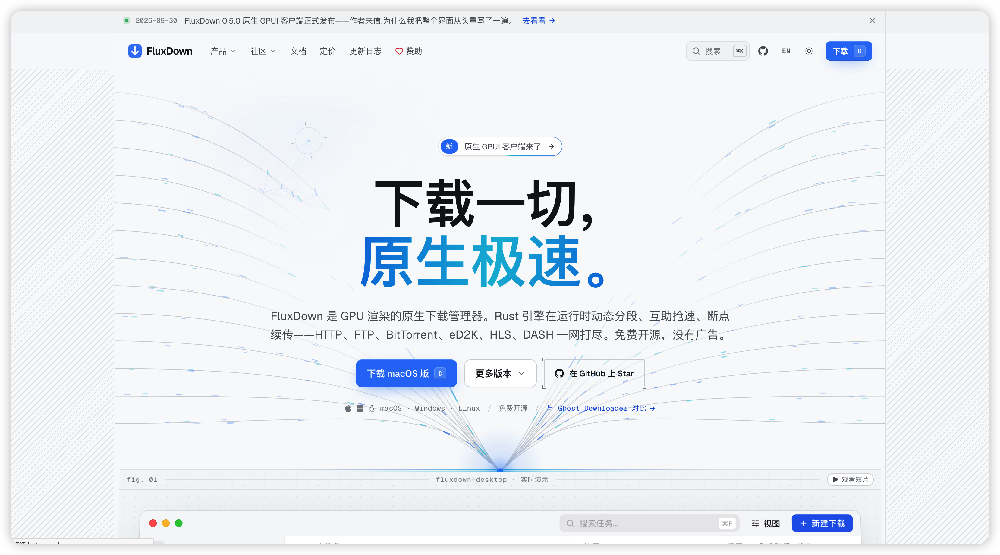
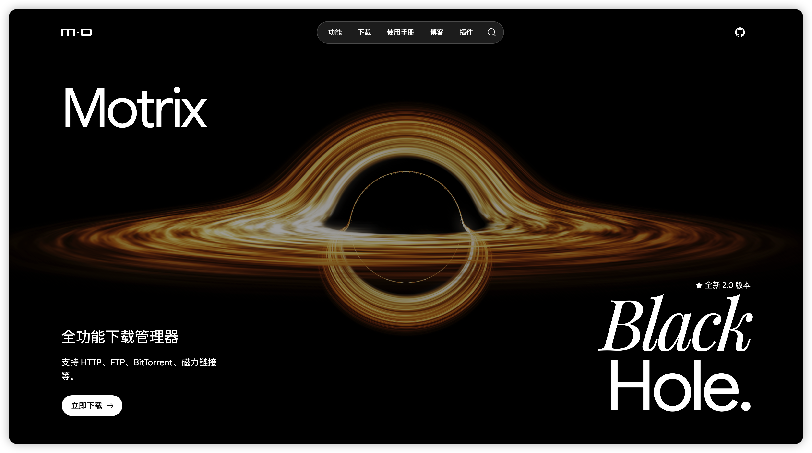
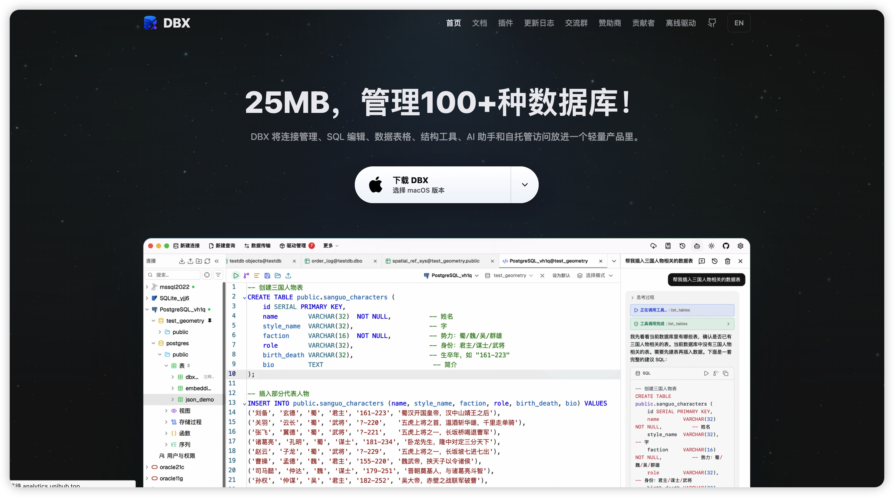

这里推荐几款我日常在用的开源软件，覆盖下载管理和数据库管理场景。

## FluxDown

> 下载一切，原生极速。

[官网](https://fluxdown.zerx.dev/zh/) · [GitHub](https://github.com/zerx-lab/FluxDown)

**软件类型**：下载软件

FluxDown 是一款 GPU 渲染的原生下载管理器，支持 HTTP、FTP、BitTorrent、eD2K、HLS、DASH 六种协议。它的亮点在于**运行时动态分段**——下载过程中会自动把最慢的分段对半拆开并接管，让任何一个慢镜像都拖不住整体速度。

进程架构上分为四层：桌面界面（GPUI）→ Agent 网关 → 守护进程 → Rust 引擎内核。窗口关闭后下载继续，重新打开立即接上实时状态。还提供浏览器扩展、CLI、Docker 无头服务器和 Android 应用。

- **语言**：Rust
- **框架**：[GPUI](https://github.com/zed-industries/zed/tree/main/crates/gpui)（Zed 编辑器背后的 Rust UI 框架，GPU 直接绘制，无 WebView、无 Electron）
- **协议支持**：HTTP/HTTPS、FTP、BitTorrent、eD2K、HLS、DASH
- **许可**：AGPL-3.0

## Motrix

> 全能下载工具，支持 BT、磁力链、HTTP 等。

[官网](https://motrix.app/zh/) · [GitHub](https://github.com/MotrixApp/Motrix)

**软件类型**：下载软件

Motrix 自 2018 年开源至今已有 57.5K GitHub 星标，是一款界面简洁清爽的下载管理器。支持 HTTP、FTP、BitTorrent、磁力链接和百度网盘资源下载，单任务最高 64 线程，最多同时 10 个任务。v2（Motrix Turbo）进行了全面重写，下载内核与界面相互独立，浏览器扩展和命令行工具通过 MDXP 协议通信。

- **语言**：TypeScript / JavaScript（前端）+ Rust（v2 内核）
- **框架**：
  - v1：Electron + Vue 2 + Vuex + Element UI
  - v2（Turbo）：Tauri 2 + Vue 3 + Pinia + Naive UI
  - 下载内核：[aria2](https://aria2.github.io/)
- **许可**：MIT

## DBX

> 25MB，管理 100+ 种数据库。

[官网](https://dbxio.com/cn) · [GitHub](https://github.com/t8y2/dbx)

**软件类型**：数据库管理工具

DBX 是一款轻量的开源数据库管理工具，桌面安装包仅约 25MB，却支持 MySQL、PostgreSQL、Redis、MongoDB、ClickHouse、DuckDB、Oracle、Elasticsearch 等 100+ 种数据库引擎，涵盖 SQL、NoSQL、向量、时序、嵌入式和消息队列。内置 AI 助手和 MCP Server，支持桌面、Docker 自托管、CLI 和 MCP 四种使用方式，共用同一套 Rust 核心。

- **语言**：Rust（核心驱动）+ TypeScript（前端）
- **框架**：Tauri 2 + Vue 3 + shadcn-vue + Tailwind CSS + CodeMirror 6
- **数据库驱动**：`sqlx`、`tiberius`、`redis-rs`、`mongodb` 等 Rust 原生驱动
- **许可**：Apache-2.0
