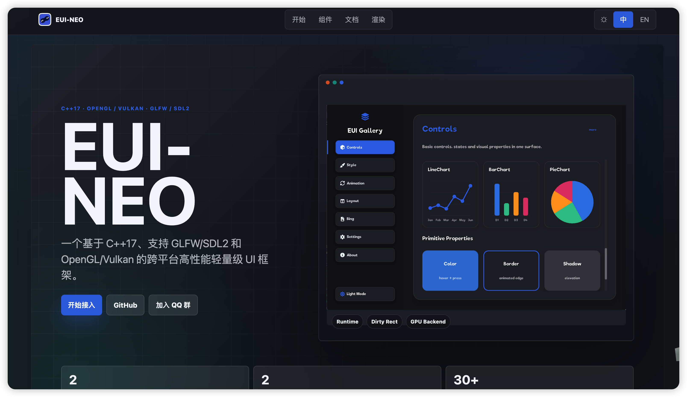
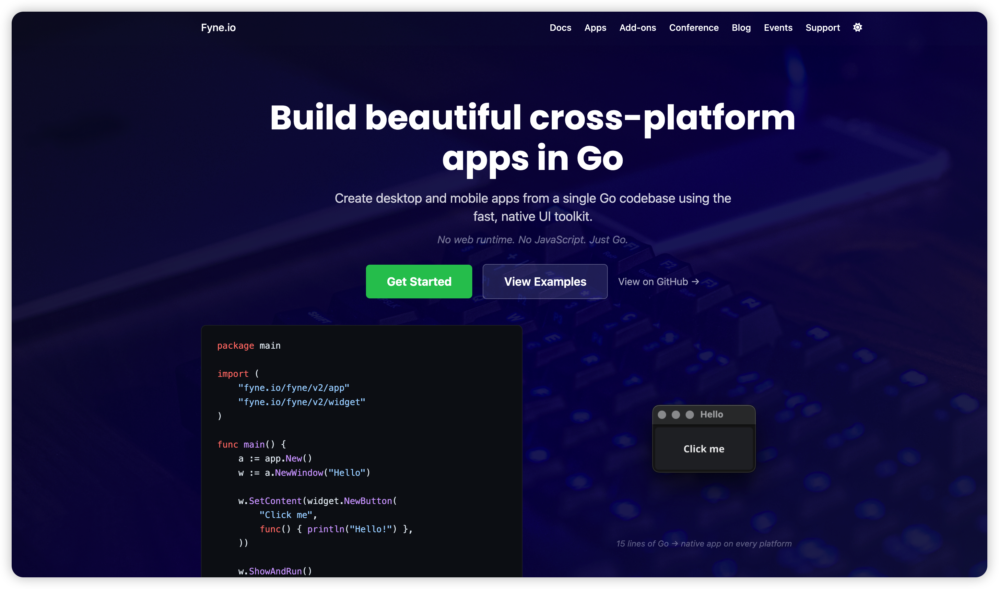
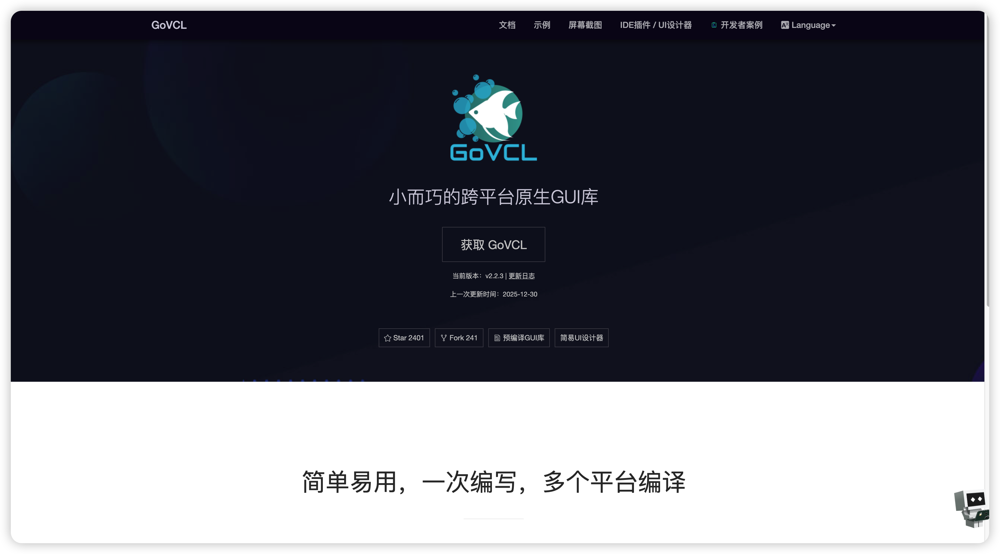
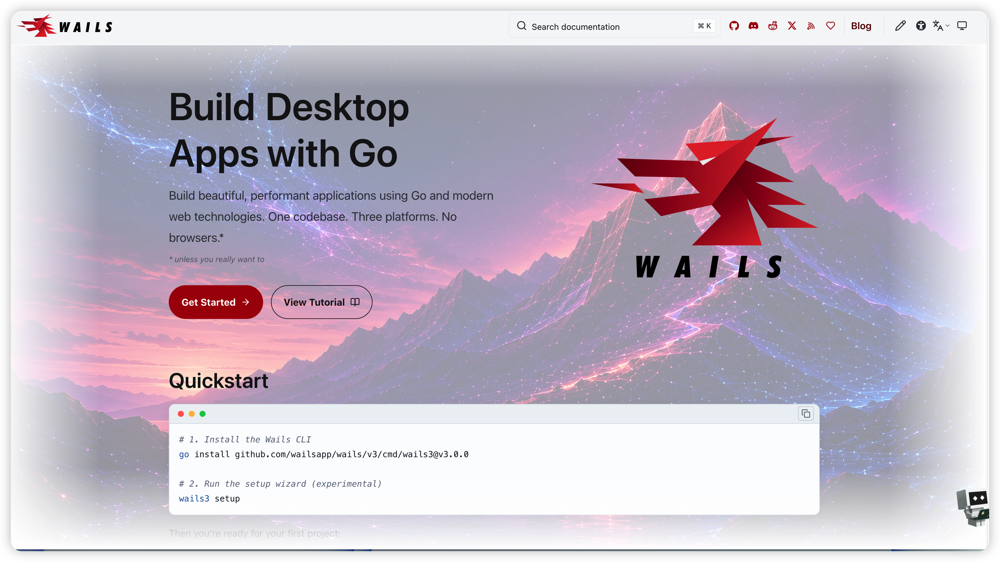
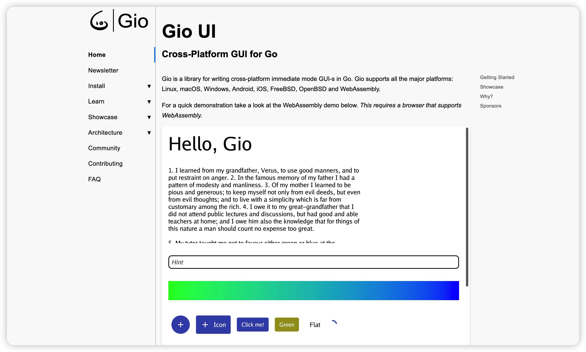
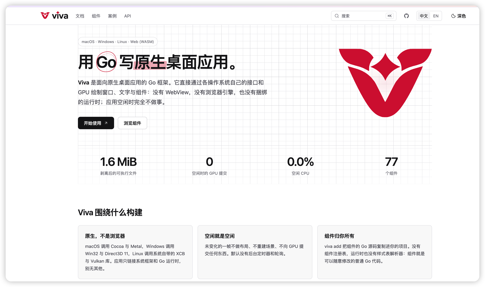
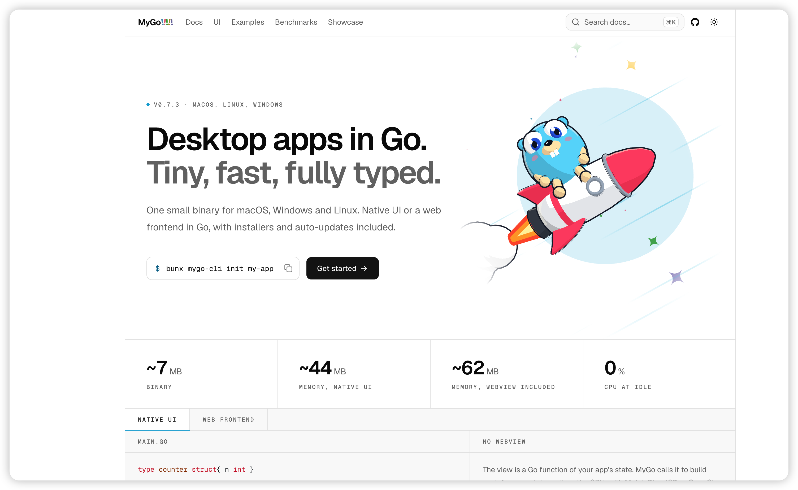

## c gui 框架
[gtk](https://www.gtk.org/)
GNOME 的 GUI 工具包，用 C 写。Linux 桌面最常用，控件接近系统原生，Windows 和 macOS 也能跑。LGPL。

[imgui](https://github.com/ocornut/imgui)
即时模式 GUI。库本身是 C++ 单头文件，C 里一般用 cimgui。不画系统原生控件，适合工具、调试面板和游戏内界面，渲染后端可以选 OpenGL、Vulkan、DirectX、Metal。MIT。

[lvgl](https://lvgl.io/)
嵌入式 C GUI。面向单片机和小屏幕，自带控件、动画和主题，桌面端可以跑模拟器。MIT。

## c# gui 框架
[winforms](https://learn.microsoft.com/zh-cn/dotnet/desktop/winforms/overview/)
.NET 里最老的 Windows 桌面方案。可视化设计器拖控件，底下是 Win32 原生控件。适合简单业务窗口，只支持 Windows。MIT。

[wpf](https://learn.microsoft.com/zh-cn/dotnet/desktop/wpf/overview/)
用 XAML 和数据绑定做 Windows 桌面，界面由 DirectX 绘制。适合比较复杂的 Windows 应用，只支持 Windows。MIT。

[winui](https://github.com/microsoft/microsoft-ui-xaml)
Windows 现在的原生 UI，Fluent 风格，也是 XAML。跟着 Windows App SDK 发布，只支持 Windows。MIT。

[maui](https://github.com/dotnet/maui)
一套代码覆盖 Android、iOS、macOS 和 Windows，控件用各平台自己的原生实现。Xamarin.Forms 的后继。MIT。

[avalonia](https://github.com/AvaloniaUI/Avalonia)
跨平台 XAML，写法接近 WPF，用 Skia 自己绘制，所以各系统外观一致。支持 Windows、macOS、Linux，也能做到移动端和浏览器。框架是 MIT；另外的 Avalonia XPF 用来兼容 WPF，那个是商业产品。

## c++ gui 框架
[qt](https://www.qt.io/)
跨平台工业级框架。Widgets 是传统控件，QML 是声明式界面，工具链和生态最全。开源协议是 LGPL，闭源商用通常要买商业授权。

[gtk](https://www.gtk.org/)
和 C 那节是同一个库。C++ 可以直接调它的 C 接口，也可以用下面的 gtkmm。

[wxwidgets](https://www.wxwidgets.org/)
把各系统的原生控件包成一套 C++ API，Windows、macOS、Linux 外观接近系统自己的。比 Qt 轻。许可证接近 LGPL，允许闭源发布。

[gtkmm](https://www.gtkmm.org/)
GTK 的官方 C++ 绑定。写起来是 C++，底层还是 GTK。LGPL。

[eui-neo](https://github.com/sudoevolve/EUI-NEO)

C++17 跨平台 UI。声明式 DSL 写布局，窗口用 GLFW 或 SDL2，渲染用 OpenGL 或 Vulkan。自带动画、异步和网络。Apache-2.0。

### c++ 推荐
| 你的需求 | 推荐框架 | 理由 |
|---|---|---|
| 大型商业应用/跨平台工业级 | **Qt** | 生态最完整，Widgets+QML 双模式，IDE 支持好 |
| Linux 原生应用/GNOME 生态 | **gtk/gtkmm** | GNOME 桌面首选，C 接口稳定，多语言绑定丰富 |
| 轻量级/学习成本低 | **wxWidgets** | 原生控件封装，接近系统原生外观 |
| 最美观的现代化 C++ UI | **eui-neo** | C++17，OpenGL/Vulkan 渲染，声明式 DSL 布局，颜值最高，自带动画/异步/网络 |

## python gui 框架
[ttkinter](https://tkinter.com/)
[pyqt6](https://pypi.org/project/PyQt6/)
[pygobject](https://pypi.org/project/PyGObject/)

## java gui 框架
[jswing](https://www.oracle.com/java/technologies/swing/overview.html)
JDK 自带的 Swing。跨平台自绘，各系统外观差不多，不走原生控件。OpenJDK 协议是 GPL，带 Classpath 例外，应用本身可以闭源。

[javafx](https://www.oracle.com/java/technologies/javafx/overview.html)
现在是独立项目 OpenJFX，Java 11 之后不再捆在 JDK 里。场景图加 CSS、FXML，界面用 GPU 绘制。协议同样是 GPL 加 Classpath 例外。

## go gui 框架
[gtk](https://www.gtk.org/)
和 C 那节是同一个库。Go 里用 gotk3 或 gotk4 绑定。

[wxwidgets](https://www.wxwidgets.org/)
和 C++ 那节是同一个库。Go 里通过绑定调用，外观接近系统原生控件。

[fyne](https://fyne.io/)

Go 写的跨平台工具包，Material 风格，OpenGL 自绘。桌面和手机都能用。BSD-3-Clause。

[govcl](https://z-kit.cc/)

Go 绑定 Lazarus 的 LCL，用的是系统原生控件，不是自绘。Windows、Linux、macOS，运行时要带 liblcl。项目已进入维护期，不再加新组件。

[wails](https://wails.io/)

用 Go 加系统自带的 WebView 写桌面应用，前端可以用 Vue、React、Svelte。不打包浏览器。Windows、macOS、Linux。MIT。

[gio](https://gioui.org/)

即时模式，GPU 绘制。Windows、macOS、Linux，也能做到移动端和浏览器。MIT 和 Unlicense 双协议。

[vivaui](https://vivaui.dev/zh/)

用 Go 写桌面应用，直接调系统接口和 GPU：macOS 是 Cocoa 加 Metal，Windows 是 Win32 加 Direct3D 11，Linux 是 X11 加 Vulkan。没有 WebView，只做桌面。组件源码可以拷进自己的项目改。

[mygo](https://mygo.egoist.dev/)

Go 桌面应用。原生界面用 GPU 绘制（Metal、Direct3D、OpenGL），也可以用系统 WebView 写前端。纯 Go，不用 cgo。macOS、Windows、Linux。MIT。Zig 的 nanoui 就是从它的原生 UI 移植过去的。

[go-gui](https://github.com/2252688138/Go-gui)
纯 Go、不用 cgo。界面用 OpenGL 自绘，风格接近现代 Web（圆角、渐变、阴影、flex 布局），也可以另带一个系统 WebView。MIT。
文章推荐：[Go-Gui:一套 无限接近 现代化UI的 GPU绘制界面组件框架](https://juejin.cn/post/7701703182474248211?share_token=8ca0fdb2-0a38-4315-9a74-ef5f3c834092)

## dart gui 框架
- [flutter](https://flutter.dev/)

### dart 推荐
| 推荐框架 | 理由 |
|---|---|
| **Flutter** | 全平台覆盖（iOS/Android/Web/Windows/macOS/Linux），Material Design 3 原生级美观，自研 Skia/Impeller 渲染引擎，Dart 语言丝滑热重载，Google 官方维护生态最强 |

## 前端 gui 框架
[electron](https://www.electronjs.org/zh/docs/latest/)
[electrobun](https://github.com/blackboardsh/electrobun)

## php gui 框架
[NativePHP](https://nativephp.com/)

## rust gui 框架

> 参考：[2025 年 Rust 桌面 GUI 框架最全横评](https://blog.csdn.net/jjhenda00/article/details/155137478) —— 基于 30+ 项目实战经验

| 框架 | 类型 | 渲染方式 | 体积 | 适用场景 |
|---|---|---|---|---|
| [iced](https://github.com/iced-rs/iced) | 即时模式 | wgpu (GPU) | 5~8 MB | Win11 风格纯 Rust 项目首选 |
| [egui](https://egui.rs/) | 即时模式 | wgpu/Web | 4~6 MB | 工具类、编辑器、调试面板 |
| [dioxus](https://dioxuslabs.com/) | React 语法 | WebView/wgpu | 4~12 MB | 桌面+Web+移动三端统一 |
| [slint](https://github.com/slint-ui/slint) | 声明式 (.slint) | 自研 GPU | 5~9 MB | 商业闭源项目 |
| [tauri](https://tauri.app/) | WebView | 系统 WebView | 3~10 MB | 前端团队快速开发 |
| [gpui](https://longbridge.github.io/gpui-component/zh-CN/) | GPU 渲染 | GPUI | — | Zed 编辑器同款引擎 |
| [makepad](https://makepad.dev/) | 自研 DSL | GPU (自研) | — | 创意应用、实时编辑、跨平台 |
| [druid](https://github.com/linebender/druid) | 保留模式 | piet | 8~12 MB | 已停止维护，继任者 Xilem |
| [fltk-rs](https://github.com/fltk-rs/fltk-rs) | 传统控件 | FLTK (C++) | 3~6 MB | 传统 Windows 工具快速开发 |
| [leptos](https://www.leptos.dev/) | 响应式 Web | WASM | — | Web 前端开发 |

### 2026 年选型建议

| 你的需求 | 推荐框架 | 理由 |
|---|---|---|
| 传统桌面应用（设置面板、文件管理器、数据库管理工具） | **iced** | 保留模式，Win11/macOS 风格原生渲染，纯 Rust 生态最成熟 |
| 工具/仪表盘类应用（调试面板、性能监控、数据可视化） | **egui** | 即时模式，体积最小、启动最快，纯 Rust 嵌入式 UI 首选 |
| 代码编辑器/IDE/通用桌面应用 | **gpui** | 纯 Rust + GPU 原生渲染，Zed 同款引擎，极致性能 |
| 音乐播放器/创意可视化/实时预览工具 | **makepad** | 自研 GPU DSL + 实时 UI 热编辑，着色器级定制渲染 |
| 桌面+Web+移动三端统一 | **dioxus** | React 语法，一套代码全平台，2026 年生态增长最快 |
| 商业闭源项目/嵌入式设备 UI | **slint** | 商业授权可选，声明式语法，极致轻量 |
| 前端团队快速出产品（音乐播放器、工具面板等） | **Tauri 2 + Vue3/React** | 复用 Web 生态，打包体积小，支持移动端 |
| 学习/快速原型 | **fltk-rs** | 极简 API，几百行即可出完整程序 |

## zig gui 框架
[nanoui](https://github.com/justrach/nanoui)
Zig 桌面 GUI。原生界面用 GPU 绘制（macOS 走 Metal，Linux 走 OpenGL，Windows 目前是 CPU），也可以嵌系统 WebView。即时模式，flexbox 布局，MIT。从 mygo 的原生 UI 移植而来。

### 喜爱的gui 框架
wails 3.0已发布,好好好
#### wails
Wails 是一个可让您使用 Go 和 Web 技术编写桌面应用的项目。
将它看作为 Go 的快并且轻量的 Electron 替代品。 您可以使用 Go 的灵活性和强大功能，结合丰富的现代前端，轻松的构建应用程序。  

功能:
- 原生菜单、对话框、主题和半透明
- Windows、macOS 和 linux 支持
- 内置 Svelte、React 、Preact 、Vue、Lit 和 Vanilla JS 的模板
- 从 JavaScript 轻松调用 Go 方法
- 自动将 Go 结构体转换为 TypeScript 模块
- Windows 上不需要 CGO 或外部 DLL
- 使用 Vite 的实时开发模式
- 可以轻松创建、构建和打包应用的强大命令行工具
- 丰富的 运行时库
- 使用 Wails 构建的应用程序兼容 Apple & Microsoft 商店

