前 11 款为开源软件，源码公开、可自行构建；接着两款为闭源商业软件，核心功能有可长期使用的免费版，进阶能力在付费商业版中解锁。文末两款为开源 Android 客户端。

1. [motty](https://motty.page/zh)

一款免费开源的原生 SSH 客户端，基于 Go + Viva 桌面框架构建，不使用 Electron，直接调用 Metal/Direct3D/Vulkan 渲染，启动不到一秒、空闲不占资源。将 SSH、SFTP、端口转发、远程桌面和 AI 助手整合进同一个原生窗口：真 PTY 终端（真彩色、5000 行回滚、分屏、录制）、带续传队列与原子替换的 SFTP（另含 SCP、ZMODEM/XMODEM/YMODEM）、本地/远程/SOCKS5/HTTP CONNECT 转发与逐跳校验的跳板链、支持证书固定的 VNC 与 RDP 标签页；AI 助手分 Ask/Agent 模式按风险分级审批，另提供仅回环的 MCP 服务器供外部代理使用。安全方面主机密钥先发前校验、保险库 AES-256-GCM 加密、密钥存系统密钥库，跨 macOS/Windows/Linux，Apache-2.0 协议开源，无需账号、无遥测。

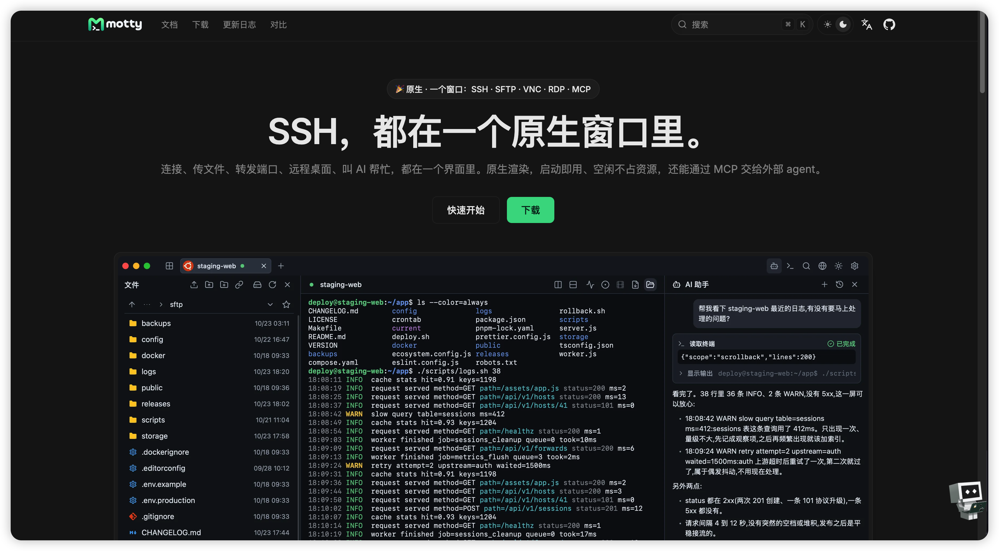

2. [meatshell](https://github.com/jeff141/meatshell)

MeatShell 是一个开源、免费、跨平台的 SSH / 终端客户端，用 Rust + Slint 编写。目标很简单：做一个轻量、低内存、启动快的 FinalShell 平替，不臃肿、不吃内存。主要特性：多标签 SSH 会话管理；完整 SFTP 文件传输（上传/下载支持取消、断点清理）；终端内 ZMODEM（sz / rz）收发；跨平台 Windows / macOS / Linux；Rust 原生，资源占用低、响应快。

b站视频[【开源】MeatShell：一个轻量级、低内存的 SSH / 终端客户端,FinalShell 平替](https://www.bilibili.com/video/BV1txjk6VEJz/?share_source=copy_web&vd_source=1ec32dba753c9cc5b488e742705c1eca)

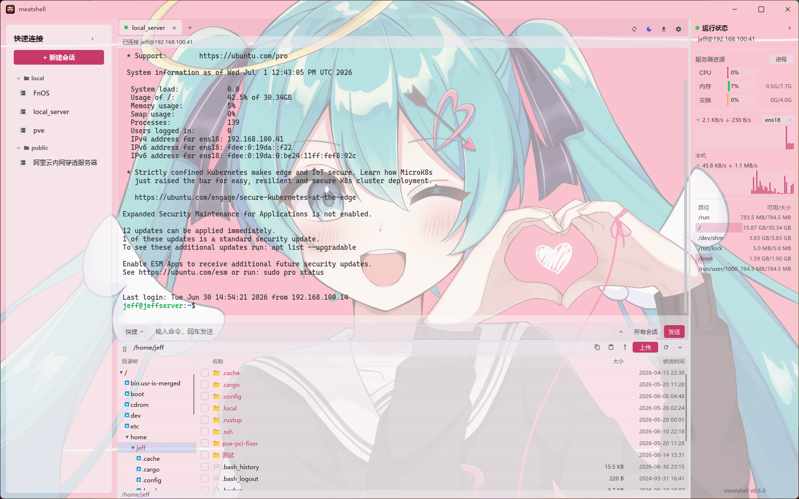

3. [rssh](https://github.com/rssh-org/rssh)

一款基于 Tauri 框架（Rust 后端 + Web 前端）的开源 SSH 客户端，主打三大差异化能力：AI 直接读取终端输入输出并提议命令（审批后执行）、命令与输出以彩色代码块呈现便于回溯、动态发现本地 Docker 容器与 K8s Pod，支持 SSH/Telnet/串口/SFTP/端口转发，跨桌面、移动端与 JetBrains 插件，MIT 协议开源。

b站视频[我用 Rust 实现 SSH 工具完整的心路历程](https://www.bilibili.com/video/BV1RGEp6ME8L/?share_source=copy_web&vd_source=1ec32dba753c9cc5b488e742705c1eca)

4. [fileterm](https://github.com/St0ff3l/fileterm)

一款面向开发者与运维团队的现代化远程桌面工作台，基于 Tauri v2 + React + Rust 构建，将 SSH 终端、SFTP/FTP/FTPS 文件管理、工作区标签页和传输任务整合在一个客户端中。核心特性包括：终端与 SFTP 文件面板联动、sudo/su 权限自动同步、Monaco 双栏文件编辑器、统一传输中心（支持断点续传）、命令模板、暗色/亮色主题与远程状态监控，跨 macOS/Windows/Linux，MIT 协议开源。

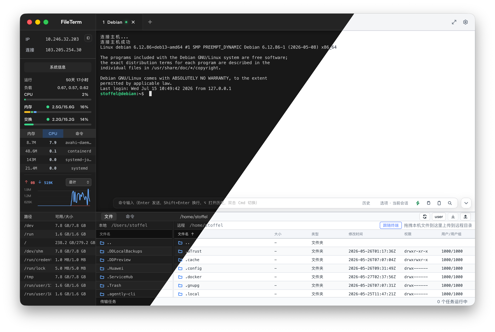

5. [navop](https://github.com/feigeCode/navop)

一款面向开发与运维的原生桌面工作台，用 Rust 与 GPUI 构建，GPU 加速渲染、不依赖 WebView。在同一个窗口里管理数据库、服务器与终端会话，并让 AI Agent 围绕真实连接、查询结果和命令输出协助工作。数据库内置 MySQL、PostgreSQL、SQLite、DuckDB、SQL Server 与 Oracle，ClickHouse、TDengine 以及达梦、人大金仓、OceanBase、openGauss 等通过可安装扩展接入，支持对象浏览、SQL 编辑与执行计划、导入导出、结构与数据对比、ER 图，以及 Redis、MongoDB 专用界面；远程侧提供可分屏的 SSH 与本地终端（快捷命令、广播输入、会话锁定、录制回放），SFTP/FTP/FTPS 文件管理（上传下载、拖拽、ZMODEM、服务器互传、远程编辑），可复用的本地/远程/动态 SOCKS 端口转发、X11 转发与主机密钥管理，并支持 RDP 与 VNC（Windows 上可在标签页内嵌入原生 MSTSC）。AI 覆盖 SQL 生成与解释、数据分析、终端协助和 Agent 工作流，可通过 ACP 接入 Codex、Claude Code、OpenCode，也可向外暴露仅回环的 MCP 服务。连接、凭据与设置支持 Navop Cloud 或个人同步（文件夹 / Git / WebDAV）加密漫游，跨 macOS/Windows/Linux，界面提供简体中文、繁体中文与英文。源码 Apache-2.0，另附补充协议：允许经免费渠道再分发，禁止商业转售与收费分发。

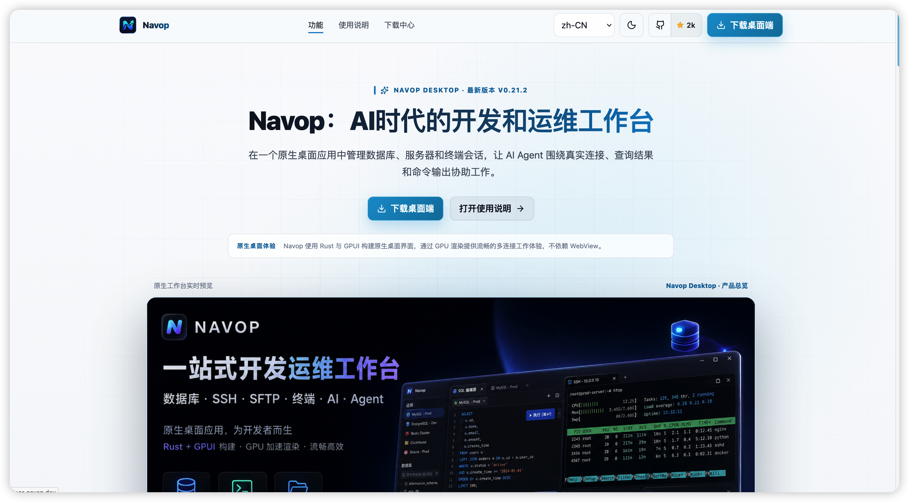

6. [hatoba](https://github.com/scarletkc/Hatoba)

一款基于 Tauri v2 构建的开源桌面 SSH 客户端，主打 AI 助手与端到端加密的自主同步。核心特性：每个终端旁内置 AI 助手，可读取屏幕、执行命令、编辑文件并联网搜索，支持 Skills 与 MCP 服务器，使用自备的 OpenAI/Anthropic API Key；同步完全运行在用户自己的 Cloudflare 账户（Workers + D1）上，无第三方服务器；数据经 Argon2id 派生密钥 + AES-256-GCM 端到端加密，本地优先、离线可用；支持主机分组标签、~/.ssh/config 导入、免 Agent 资源监控、SFTP 面板、端口转发、2FA 认证，以及通过 `hatoba` 命令让 Claude Code/Codex 等编码代理操作已保存主机，Windows 优先，MIT 协议开源。

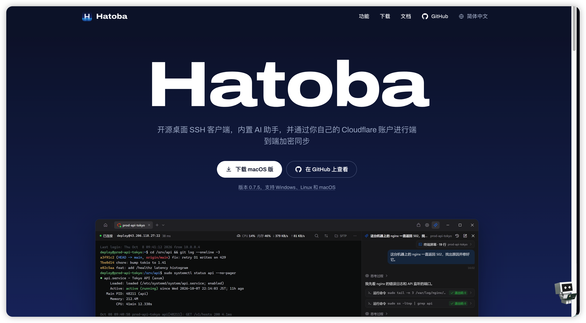

7. [qssh](https://github.com/nanxiangxi/qssh)

一款中文界面的开源 SSH 远程连接工具，主打「好看第一，好用第二」，不追求极致性能而追求视觉舒适。基于 Go + Wails v3（后端）与 Vue 3 + xterm.js（前端）构建，便携免安装、双击即用。核心特性：暗色主题多标签终端、SFTP 文件管理、内置 AI 助手、本地/远程端口转发、防火墙管理（iptables/firewalld/ufw）、systemd 进程守护管理、批量命令执行与连接管理。主要支持 Windows 10+，macOS/Linux 理论可用，基于 CC BY-NC-SA 4.0 协议开源（非商用）。

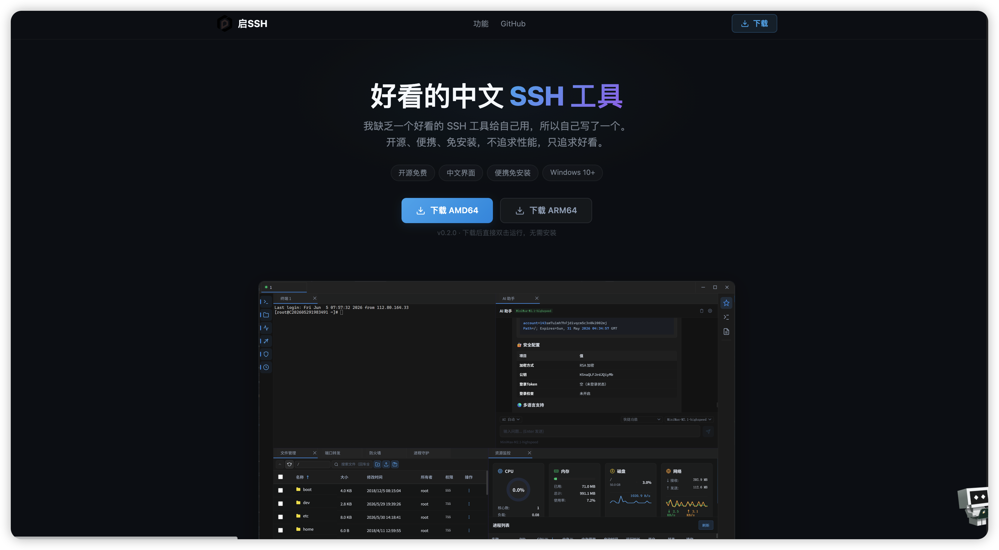

8. [crabport](https://github.com/chi11321/CrabPort)

一款跨平台终端，将 SSH、Telnet、串口、SFTP、隧道、代理路由与内置轻量 AI 代理整合进同一个窗口，使用 Rust 编写并基于 Zed 编辑器的 GPU 加速 UI 框架 GPUI 渲染。每个主机条目自带凭据、代理与串口配置，终端标签页附带 SFTP、隧道与 shell 历史，以及专属 AI 助手面板。内置 AI 代理可读取终端输出、在带外执行命令或输入到实时 shell、读写本地文件、发送 HTTP 请求、定义临时隧道、通过 SFTP 浏览传输文件，所有工具调用均需审批卡片确认（可按工具设为免问或禁止），长对话自动压缩。凭据 AES-256-GCM 加密存储于本地 SQLite，代理层支持直连/SOCKS5/HTTP CONNECT，后端共享单一 tokio 运行时，跨 macOS/Linux/Windows，Apache-2.0 协议开源。

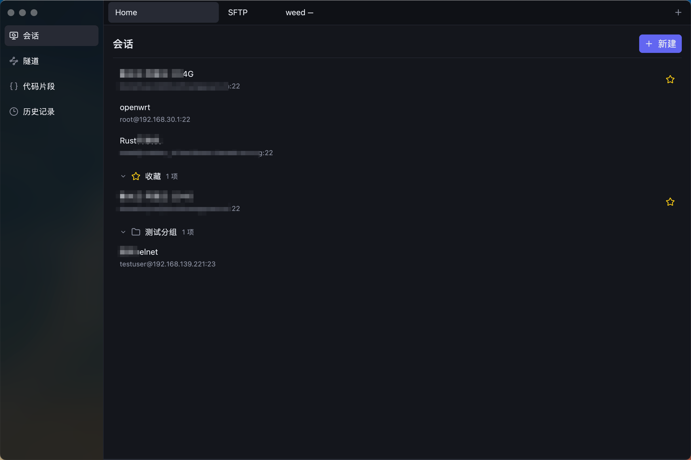

9. [aether-ssh](https://github.com/angusdevgo/Aether-SSH)

一款轻量级、高性能且极具设计感的多端跨平台 SSH 终端管理软件，基于 React 18 + Wails（Go 后端）构建。核心特性：原生级全异步 PTY 引擎配合预测本地回显，高延迟网络下依然跟手丝滑；Glassmorphism 玻璃拟态美学设计，深浅色动态主题；免 Agent 的系统级原生资源监控（CPU/内存/网络实时曲线）；ResizeObserver 智能布局实现终端零裁剪重绘；内置 AES-GCM 256 位加密的 WebDAV 增量同步，多端无缝漫游，MIT 协议开源。

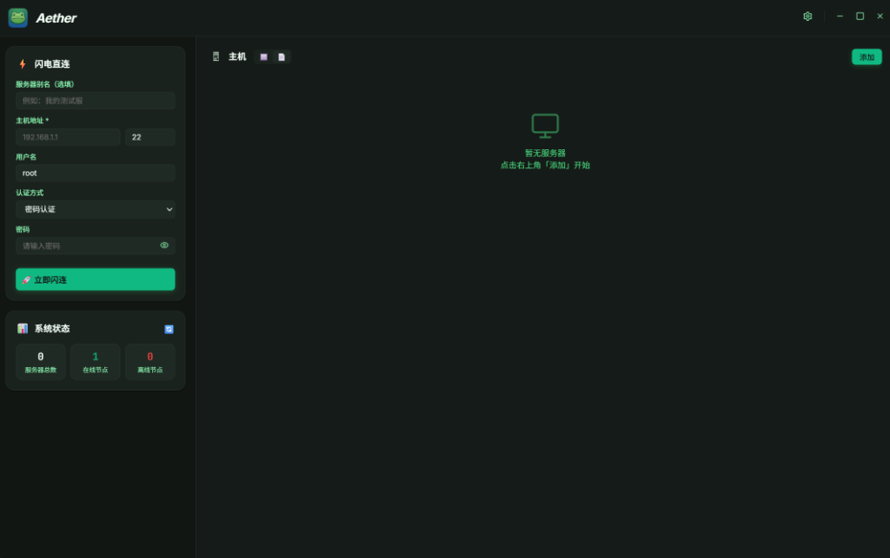

10. [btshell](https://blob.btshell.top/)

一款开源、简洁高效的 SSH 运维管理工具，由 Flutter + Rust 开发，目标是提升工作效率。核心功能：SSH 连接（支持 SOCKS5 代理、跳板机、快速重开、trzsz 文件传输）、Telnet 与串口；Starship 主题与自定义外观；本地网络监控与服务器 CPU/内存/负载监控；终端搜索高亮、链接打开、记录下载；文件管理支持键盘首字母定位、拖拽上传、右键编辑/重命名/解压/压缩/改权限、双击编辑并监听自动保存；网络连接统计、进程查询（右键 kill）、目录大小统计、Linux 命令学习文档与常用软件安装脚本；历史记录路径与命令快速过滤、收藏；PWD 路径联动、Docker/Podman 镜像容器管理；支持通过 GitHub/Gitee 同步配置数据，计划推出免费版与付费版。

11. [eussh](https://github.com/WillSat/eussh)

一款基于 Tauri v2 构建的跨平台 SSH 客户端，界面简洁、性能出色。核心功能：VS Code 风格 Activity Bar 快速切换；多服务器同时连接、一键切换且终端完全独立，单服务器可开多个终端与文件管理器标签；服务器总览页含 CPU/内存/磁盘/交换分区实时监控、世界地图定位与全 IP 展示；文件管理器支持列表/图标视图、拖拽上传、右键权限管理；批量命令执行支持 `{{host}}` 等模板变量；主机密钥 TOFU 验证并持久化 known_hosts；网络闪断自动指数退避重连（最多 5 次）。技术栈为 Vue 3 + Vite + Pinia + Tailwind CSS + xterm.js，SSH 采用纯 Rust `russh` 实现（无 C 依赖），连接配置 AES-256-GCM 加密存储，支持中文/英文双语，MIT 协议开源。

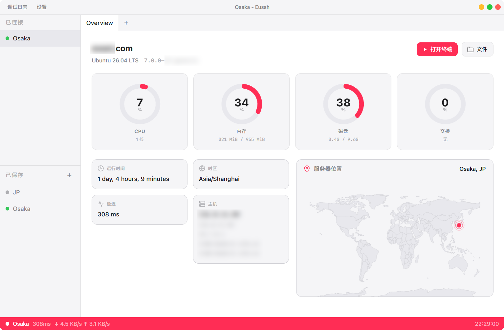

12. [ishellpro](https://ishell.cc/zh-CN)

一款闭源商业软件，原生编译的高性能全协议终端管理工具，一站式支持 SSH、SFTP、RDP、VNC、Telnet、串口六大协议，内置 AI 助手、免 Agent 实时监控与 SSH 隧道，安装包不到 30MB、秒级启动，覆盖 Windows/macOS/Linux/Android/iOS 全平台。免费版长期可用，涵盖 SSH、本地终端、SFTP、Telnet 等核心连接；RDP、VNC、串口限制主机数量，会话录制带水印。商业版分年付 Pro 与买断 Pro，解锁不限主机数的全协议、GPU 与进程监控、加密云同步、无水印录制、更高的每月 AI Tokens，以及桌面端与移动端的全部特性。另有政企版：编译阶段移除自动更新、云同步、在线支付与遥测，用离线许可证激活，AI 可对接内网 Ollama。

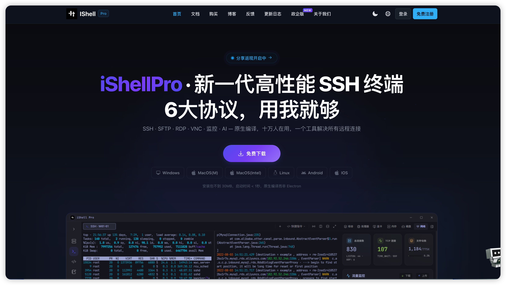

13. [hexhub](https://hexhub.com/)

一款闭源商业软件，集 SSH、SFTP、数据库管理、Docker 管理与 AI Agent 于一体的开发运维桌面客户端，相当于 XShell + Navicat + Portainer 的组合，支持用自然语言让 AI 协助查日志、改配置、写 SQL。免费版永久免费，开放 90% 以上核心功能，覆盖数据库、SSH、SFTP 与 Docker，适合个人日常使用。商业版分专业版与增强版：专业版支持同时登录 3 台设备，包含云端或私有协议同步、多窗口、数据与表结构同步、SFTP 服务器互传、SSH 命令广播，以及 Docker 文件管理与 Compose 编辑；增强版包含专业版全部权益，同时登录设备数提高到 6 台。企业还可单独申请私有化部署。

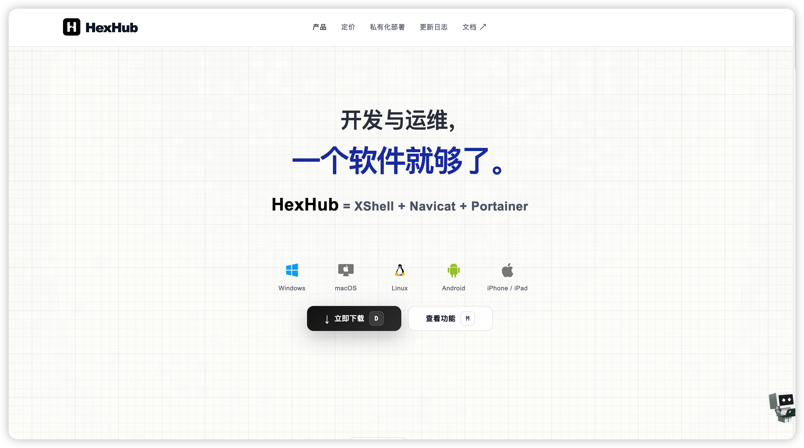

手机端

14. [connectbot](https://connectbot.org/)

一款面向 Android 的开源 SSH 与 Mosh 客户端，自 2007 年持续维护，用来在手机上连接 Linux 服务器、树莓派或远程开发机。支持多会话并行并在主机之间切换，可用密码或 SSH 密钥登录，并提供端口转发；Mosh 可在切换网络或短暂断线后恢复终端（需服务端安装兼容软件）。终端可固定特殊按键、复制回滚内容，并自定义颜色与字号，另支持 Telnet 与 SFTP。可从 Google Play 或 GitHub Releases 安装（含体积更小的 google 版，以及自带加密库的 oss 版），Apache-2.0 协议开源。

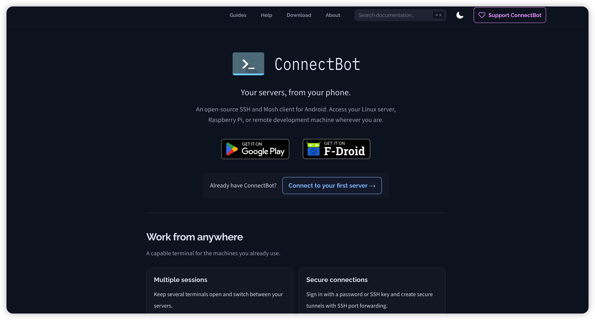

15. [haven](https://glasshaven.github.io/Haven/zh/)

一款面向 Android 的开源远程工作台，AGPLv3 协议，无遥测、无广告、无需账户，最低 Android 8.0。终端支持 Mosh、Eternal Terminal 与 SSH，以及 USB/蓝牙/BLE 串口和 tmux 会话恢复；桌面侧覆盖 VNC、RDP、SPICE，并带 GPU 加速的原生 Wayland 合成器。文件与云存储支持 SFTP/SCP、SMB 和 60 多个云服务商（rclone），可跨文件系统复制与移动，另含 FFmpeg 转码。连接方面支持本地/远程/动态端口转发与跳板、SOCKS/HTTP/Tor 代理、按应用的 WireGuard 与 Tailscale 隧道、端口敲门，以及 SSH 密钥与 FIDO2。设备上可通过 PRoot 免 root 运行 Alpine、Debian、Ubuntu 等发行版，arm64 上也可以用户态 Linux 启动完整内核；另提供约 230 个需授权的 MCP 工具，供智能体操作连接与界面。备份以 AES-256-GCM 加密，界面含简体中文等 12 种语言，可从 F-Droid 或 GitHub Releases 安装。

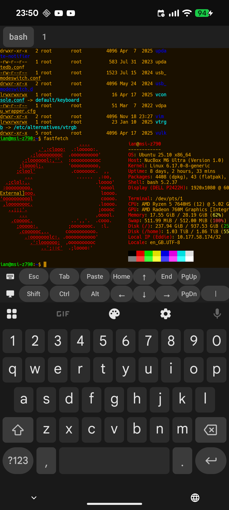
